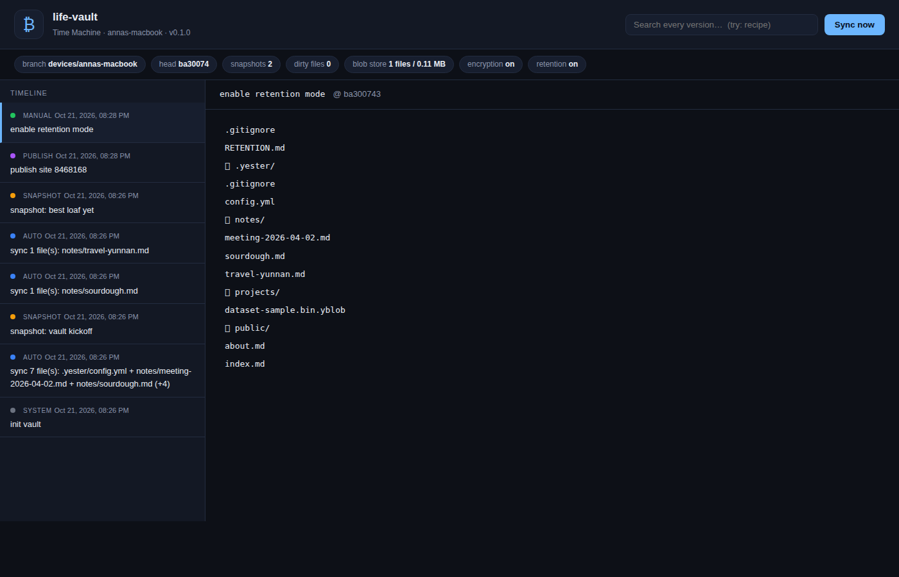

# Yester

**A time machine for every folder you own.**

Local-first, Git-powered file versioning. One watched folder becomes an
infinitely rewinding archive of your notes, documents, bookmarks and
projects — no subscription, no account, no lock-in.

[](https://github.com/yuyu2929/yester/actions/workflows/ci.yml)
[](LICENSE)
[](pyproject.toml)
[](tests/)



---

## Why

Your code lives in git and gets immortality for free. Everything else —
notes, drafts, that recipe you finally perfected — rots in a sync folder
with no history, or in a subscription that ends when you stop paying.

Yester fixes the asymmetry. Drop a folder in, and every save becomes a
commit you can rewind to, diff, search across, publish from, encrypt,
and archive to as many remotes as you like.

**The pitch in one line:** your files, your disk, your rules — the cloud
is just an optional, encrypted, replaceable mirror.

## What you get

| | |
|---|---|
| ⏱ **Time Machine** | Auto-commits every few minutes; labelled snapshots; browse, diff and restore any version of any file from a local web UI |
| 🌍 **Publish** | `public/` renders to a static site and pushes to `gh-pages` — your digital garden, zero config |
| 🔐 **Encryption** | End-to-end encrypted mirror (AES-256-GCM); plaintext never leaves your machine; passphrase + recovery code |
| 🔍 **Search** | Full-text search across *every version* of every file — English and Chinese |
| 🏛 **Archive & inherit** | One command replicates everything to N remotes; hand-over documents for digital inheritance |
| 📋 **Compliance** | Git history as an attributable audit trail; secret scanning; retention mode |

## Quickstart

```bash
pip install yester            # or: pipx install yester

cd ~/Documents
yester init my-vault          # creates the vault
cd my-vault
yester watch                  # auto-versions everything, forever
yester ui                     # open the Time Machine → http://127.0.0.1:8787
```

That is the whole personal workflow. Everything else is opt-in.

### 快速开始（中文）

```bash
pip install yester
mkdir ~/我的保险库 && cd ~/我的保险库
yester init . --name "我的保险库"
yester watch          # 之后每次保存文件都会被自动版本化
yester ui             # 浏览器打开“时光机”： http://127.0.0.1:8787
```

## The six directions

### 1. Time Machine — *why people install it*

```bash
yester sync                 # commit pending changes now
yester snapshot "v1.2"      # labelled snapshot (commit + tag)
yester log                  # history at a glance
yester restore notes/a.md   # roll a file back (current state saved first)
yester ui                   # timeline, file tree, diff, restore — in a browser
```

Every device works on its own branch (`devices/<name>`); `main` stays
canonical. `yester promote` hands the main branch to a new device and
keeps the old one as `main-backup-<timestamp>`.

Large files (default > 25 MB, configurable down to KB) are moved to a
content-addressed blob store and replaced by tiny pointer files, so
repositories stay small enough for free hosting.

### 2. Publishing — *why people share it*

```bash
mkdir public
echo "# Hello" > public/index.md
yester publish --no-push            # build only
yester config set publish.remote git@github.com:you/site.git
yester publish                      # build + push to gh-pages
yester publish --preview            # local preview on :8788
```

### 3. Encryption — *why people trust it*

```bash
yester encrypt-init                 # prints a recovery code — store it
yester mirror                       # build the encrypted mirror
yester mirror --push                # …and push it to remotes.origin

# on a new machine:
git clone <mirror-remote> mirror
yester unlock mirror ./restored
yester unlock mirror ./restored --recovery "XXXX-…"
```

The plaintext vault is **local-only by default** and refuses to push
while encryption is on. What goes to the cloud is ciphertext — file
contents *and* names — sealed with AES-256-GCM under a master key that
is itself wrapped by your passphrase (scrypt) and a recovery code.

### 4. Search — *why people stay*

```bash
yester search --reindex "防晒霜"      # index every snapshot & commit
yester search "sourdough"             # ranked hits with revision + snippet
```

TF-IDF cosine ranking with CJK bigram segmentation — Chinese notes are
searchable with zero external services.

### 5. Archive & inheritance — *why it lasts*

```bash
yester remote add github  git@github.com:you/vault-archive.git
yester remote add gitea   https://gitea.example.com/you/vault.git
yester archive --label "2026 annual"  # push everything everywhere
yester inherit --heir "Sam" --contact "sam@example.com"
```

"Forever" is a systems property: one host can disappear, so Yester
replicates to every remote you configure and records an
`ARCHIVE-MANIFEST.json`. `yester inherit` writes a hand-over document
so a designated heir can restore the mirror.

### 6. Compliance — *why organisations pay*

```bash
yester activate YESTER-TEAM-…        # offline licence check, no phone-home
yester audit --format csv --output q3.csv
yester scan                          # secrets & PII before they enter history
yester lock                          # retention mode: no auto-gc, history preserved
```

Git history is already an immutable, attributable change log. Yester
turns it into auditor-ready exports (JSON/CSV), blocks credentials and
PII from ever being committed, and can freeze history rewrites.

## Editions

| Capability | Personal | Team | Enterprise |
|---|---|---|---|
| Watch, auto-commit, snapshots, Time Machine UI | ✅ | ✅ | ✅ |
| Unlimited local repos, your own remotes | ✅ | ✅ | ✅ |
| Encrypted mirror, publishing, search, archive, inheritance | ✅ | ✅ | ✅ |
| Audit export (`yester audit --export`) | — | ✅ | ✅ |
| Retention mode (`yester lock`) | — | ✅ | ✅ |

Personal is genuinely free: the heavy lifting happens on your machine
against remotes you already own. The Team licence adds the two compliance
features above plus support.

Not on this table, on purpose: custom publishing domains, semantic search
and SSO are **roadmap items, not products**. They are listed in
`license.PLANNED_FEATURES` and no licence unlocks them today.

Secret scanning (`yester scan`, `yester hook`) is **free** — it shipped
free in 0.1.0 and taking it back would be worse than leaving it in.

## Security model

- **Local-first.** Plaintext never leaves the machine unless you
  explicitly configure a plaintext remote (you usually shouldn't).
- **Sealed before upload.** Per-file AES-256-GCM; the master key is
  wrapped by passphrase (scrypt, n=2¹⁵) *and* a recovery code.
- **Names hidden too.** Blobs are flat (`sha256(path).enc`) and the
  path→blob map lives in an encrypted `manifest.enc`. A remote sees file
  count and approximate sizes, not names or the folder tree.
- **Authenticated.** Restoring from a tampered mirror fails loudly.
- **Honest limits.** Lose the keyfile, the passphrase *and* the recovery
  code and the mirror is gone — Yester tells you this at init, it does
  not pretend otherwise.
- **No telemetry, no accounts, no phone-home.** Licence checks are
  offline format checks — and, being checksums in an open-source client,
  they are a product boundary, not a security boundary. We say so instead
  of pretending otherwise.

## FAQ

**Is this a backup tool?**
No — and that is deliberate. Your disk is the source of truth; git is
the *versioning and sync* layer. Real redundancy comes from
`yester archive` to multiple remotes. (Git hosts explicitly discourage
being used as generic backup, and Yester respects that.)

**Why not just use Dropbox / Syncthing / Obsidian-git?**
Syncthing syncs but has no history UI. Obsidian-git is great for
Obsidian only. Dropbox's versioning is a subscription and a black box.
Yester is folder-agnostic, self-hosted in spirit, and gives you the
whole toolbox: history, diff, search, publish, encryption, archive.

**Does it work with large files / videos?**
Oversized files go to the blob store automatically. Sync the blob store
with rsync to a NAS or any target you control.

**Windows / macOS / Linux?**
Python 3.9+, all three, same commands.

## Project layout

```
yester/
├── cli.py          # command line entry point
├── gitops.py       # vault lifecycle, branches, snapshots, blob store
├── watcher.py      # filesystem watching, debounced auto-sync
├── crypto.py       # key handling, sealed mirror, unlock
├── publisher.py    # public/ → static site
├── search.py       # cross-version TF-IDF index (EN + CJK)
├── archive.py      # multi-remote archive, inheritance
├── audit.py        # audit export, secret scan, retention
├── license.py      # offline licence gate (open-core)
├── timemachine.py  # local web UI (Flask)
└── templates/, static/
tests/              # 31 tests, run with: pytest
docs/
├── design.md       # design rationale (Chinese)
├── devlog.md       # development log (Chinese)
└── architecture.svg
```

## Development

```bash
pip install -e '.[dev]'
pytest -q            # 31 passed
```

## License

MIT for the app — see [LICENSE](LICENSE). Paid editions and commercial terms: [COMMERCIAL.md](COMMERCIAL.md). Changes: [CHANGELOG.md](CHANGELOG.md).

*Yester is an independent project. It builds on git and standard
cryptography; it is not affiliated with any git hosting provider.*
