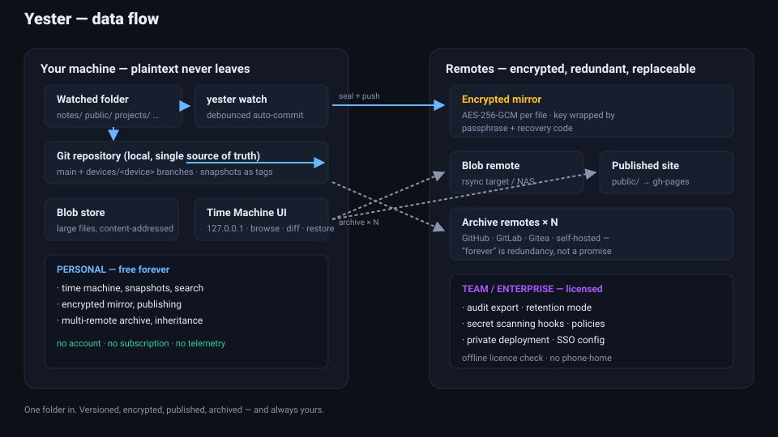

# Yester 设计思路

> 版本：v0.1.0 · 日期：2026-10-21
>
> 本文档记录 Yester 的产品定位、六大方向的设计论证、架构决策与商业模型，是项目的"为什么"，与 README 的"是什么"互为补充。

---

## 1. 一句话定位

**Yester 是给普通文件夹装上的时光机：本地优先、Git 驱动、零订阅的个人文件版本化工具，外加一层让企业愿意付费的合规与安全能力。**

英文 tagline：*A time machine for every folder you own.*

## 2. 核心判断：这个创意为什么值得独立成产品

### 2.1 不对称性

代码项目天生享有 git 的"不朽性"：每一次改动都有历史、可回滚、可审计。而普通人更重要的资产——笔记、草稿、证件扫描件、旅行计划、收藏的网页——却躺在同步盘里，没有历史，或者历史锁在订阅制产品的服务器里。

这个不对称就是产品机会：**把 git 的版本能力从代码扩展到一切文件，并且把"订阅制云盘"改写为"一次性下载、永久拥有"。**

### 2.2 对经典批评的回应

该领域最有分量的反对意见是："Git 不是备份工具"（git 官方 wiki 原话），且主流托管平台明确建议仓库小于 1GB、强烈建议小于 5GB，并警告过度占用基础设施会收到整改邮件。

Yester 的设计正面回应了这三点，而不是绕开：

1. **重新定义角色**——本地磁盘永远是唯一真相源（single source of truth），git 是*版本层与同步层*，不是备份层。宣传语从"备份"改为"时光机与同步"，这不是文字游戏，而是架构事实：删掉云端，本地完好无损。
2. **仓库体积治理**——超过阈值（默认 25MB，可配置到 KB 级）的文件自动进入内容寻址 blob 存储（`.yester/blobs/`），git 里只留几字节的 `.yblob` 指针文件。普通用户的仓库因此可以常年保持在几 MB。
3. **冗余而非单点**——"forever"是系统工程属性，不是承诺。`yester archive` 一键推送到所有已配置的远程（GitHub / GitLab / Gitea / 自建），并记录 `ARCHIVE-MANIFEST.json`。单一托管商消失不影响数据存活。

### 2.3 为什么个人会下载、传播，企业会付费

| 对象 | 获得的核心价值 | 付费触发点 |
|---|---|---|
| 个人用户 | 免费、无账号、数据主权、"随时回得去"的掌控感 | 无（真免费） |
| 团队/企业 | 同一套工具的合规形态：审计、留痕、防泄密、私有化 | 管控、合规、安全、支持 |

个人版必须是**真免费且功能完整**：重活都在用户自己的机器上跑，远程用用户已有的 git 托管，边际成本为零。付费墙只架在"管控、合规、安全、组织"四类企业刚需上——这是开源核心（open-core）模型的经典切法，与 GitLab CE/EE 的切法同构。

## 3. 六大方向的设计论证

每个方向都同时回答两个问题：**个人为什么因此下载/传播，企业为什么因此付费。**

### 方向一：时光机（引流主力）

- **设计**：监视文件夹 → 防抖自动提交；`snapshot` 打标签快照；本地 Web UI（Flask，127.0.0.1）提供时间线、文件树、双版本 diff、一键还原（还原前自动安全快照）。
- **个人价值**：5 分钟内体验到"哇"的时刻——拖动时间线看自己三个月前写了什么，误删一键还原。这是截图传播的素材，是增长引擎。PKM（Obsidian/Logseq/笔记）用户、写作者、研究者是天然受众。
- **企业价值**：本身不付费，但是整个漏斗的顶端。
- **关键决策**：单仓库而非"子文件夹各一仓库"（社区原案）。单仓库让搜索、审计、UI 全部大幅简化，且现代 git 托管对单仓库更友好。多仓库语义用目录约定（`notes/`、`projects/`）表达，心智负担更低。

### 方向二：发布器（增长杠杆）

- **设计**：`public/` 目录的 Markdown 自动渲染为静态站，推送到 `gh-pages` 分支；私密内容（`private/` 或其余目录）与公开内容物理隔离。
- **个人价值**："数字花园"是当下知识管理热词。写作者零配置拥有个人站点——不用学 Hugo/Hexo，文件夹结构即网站结构。这是社交媒体上最容易传播的功能演示。
- **企业价值**：内部文档站、变更日志、API 文档的自动发布流水线；自定义域名（Team）。

### 方向三：零信任加密（安全溢价）

- **设计**：明文仓库本地-only；推送到云端前构建加密镜像——每个文件用 AES-256-GCM 单独封装（nonce 随机），主密钥随机生成，分别被口令（scrypt, n=2¹⁵）和恢复码包裹后存于 `.yester/keys/vault.key`（0600）。镜像内含密钥包装文件（只有"包裹后"的密钥，单独泄露无用）。
- **个人价值**："连托管平台员工都读不到你的内容"是最好的安全文案；记者、律师、财务敏感人群刚需。
- **企业价值**：BYOK、密钥托管策略、加密审计报告——企业安全采购清单上的硬条目。
- **威胁模型**（写进代码文档）：泄露的镜像仓库在没有口令/恢复码时无用；但丢失密钥文件+口令+恢复码三者，镜像即不可解密——Yester 在初始化时明确告知，不伪装成"忘了密码也能找回"。

### 方向四：跨版本搜索（留存利器）

- **设计**：对 HEAD、全部快照标签、最近 40 个提交建 TF-IDF 索引（doc = 版本×文件）；英文分词 + 中文 CJK 二元组（bigram）切分，零外部依赖；索引存 `.yester/index/search.json`。
- **个人价值**："我三月份写过的那段话"——跨版本语义检索是个人版里少见的"用了就回不去"的功能，也是免费转付费的钩子（Team 解锁完整 AI 摘要等）。
- **企业价值**：知识资产的合规检索；DLP 敏感信息扫描（提交前识别身份证号/密钥并告警）同属此族。

### 方向五：归档与数字遗产（情感溢价）

- **设计**：`archive` 推送到 N 个远程并写清单；`inherit` 生成移交文档（继承人、联系方式、恢复码位置、解密指引）。
- **个人价值**：把 "forever" 从口号变成可执行仪式——指定继承人，像写数字遗嘱。这是情怀卖点，也是口碑传播点。
- **企业价值**：长期归档套餐、法律保全（legal hold）。

### 方向六：合规层（商业化主引擎）

- **设计**：git 历史天然是不可篡改、可归属的变更日志。`audit export` 输出 JSON/CSV（设备、时间、类型、文件数）；`scan` 用保守正则集检测 AWS/GitHub/Slack 密钥、私钥块、身份证号、手机号、邮箱、通用密钥赋值，脱敏报告 + 退出码 1（可直接当 pre-commit hook）；`lock` 开启留存模式（关闭自动 gc、冻结历史改写）；`activate` 离线校验许可（格式+校验和，无电话上报）。
- **个人价值**：用不到，但"这个工具长大了也有路可走"让人敢依赖。
- **企业价值**：等保/GDPR/SOC2 要的"谁在何时改了什么"证据链；私有化部署满足数据不出境；SSO/SAML、管理后台、SLA——**企业从来不为存储付费，为管控付费**。

## 4. 架构与数据流



```
你的机器（明文永不离开）                远程（加密、冗余、可替换）
┌─────────────────────────┐          ┌──────────────────────────┐
│ 被监视的文件夹            │  seal    │ 加密镜像 (AES-256-GCM)    │
│   ↓                     │ ───────► │   remotes.origin         │
│ yester watch（防抖）      │          ├──────────────────────────┤
│   ↓                     │  rsync   │ Blob 远程（NAS/对象存储）  │
│ Git 仓库（唯一真相源）     │ ───────► ├──────────────────────────┤
│   main + devices/<设备>  │  push    │ 发布站点 (gh-pages)       │
│   ↓                     │ ───────► ├──────────────────────────┤
│ Blob 存储（大文件隔离）    │  push ×N │ 归档远程 × N              │
│   时光机 UI (127.0.0.1)  │ ───────► └──────────────────────────┘
└─────────────────────────┘
```

### 4.1 关键机制

- **分支模型**：`main` 为规范分支；每设备工作于 `devices/<设备>`；每次提交后自动把设备分支快进（或合并）进 `main`——多设备同步的真实语义，同时保证审计读 `main` 即可获得完整历史。`promote` 让新设备的分支成为 main，旧 main 改名存档。
- **大文件隔离**：超阈值文件 → blob 存储 + `.yblob` 指针；原文件路径写入 `.git/info/exclude`。**关键细节**：被托管的文件之后再次编辑时，`git status` 不可见（已忽略），因此同步流程必须显式刷新指针（比对 sha256）——这是实现中发现并修复的真 bug（见 devlog）。
- **提交消息约定**：`yester(<kind>): <subject>`，kind ∈ system/snapshot/auto/manual/restore/publish/archive/audit 全部由此解析，审计模块零额外状态。
- **时光机 UI**：纯本地 Flask，无账号无遥测；`/api/timeline`、`/api/tree`、`/api/file`、`/api/diff`、`/api/restore`、`/api/search`。

### 4.2 技术选型

| 选择 | 理由 |
|---|---|
| Python + watchdog | 跨平台文件监视的标准答案；原型快，社区大 |
| git CLI 子进程（非 pygit2） | 零额外二进制依赖；行为与用户手工 git 完全一致 |
| Flask（时光机 UI） | 本地单页应用足够；避免引入前端构建链 |
| cryptography（AESGCM + Scrypt） | 审计充分的原语，不自己造密码学 |
| TF-IDF 自研索引 | 零依赖、可解释、中英文兼顾；embedding 检索留作扩展点 |

## 5. 商业模型（open-core）

- **Personal（免费）**：全部个人能力完整可用——时光机、快照、搜索、加密镜像、发布、归档、继承。用户用自己的 git 托管，Yester 不承担任何服务成本。
- **Team（按席位）**：审计导出、留存模式、扫描 hook、发布自定义域名、语义搜索增强。
- **Enterprise**：私有化部署工具、SSO/SAML 配置、SLA 与专属支持。
- **原则**：许可校验离线进行（格式 + 校验和），无电话上报、无遥测。付费墙是产品边界而非安全边界——代码全部可审计，这一点明确写入文档，反而是企业采购时的信任资产。

## 6. 风险与路线图

**已识别风险**

| 风险 | 缓解 |
|---|---|
| 托管平台 ToS 不鼓励当备份 | 定位为"版本层"；加密镜像 + blob 隔离控制仓库体积；企业场景默认私有化 |
| 大文件场景性能 | blob 存储 + rsync；文档明确边界 |
| 与 git 的深层集成（冲突、合并）复杂度 | 单用户单设备分支模型避免多数冲突场景；合并走标准 git merge |
| 密钥丢失 | 恢复码 + 继承文档 + 明确的威胁模型说明 |

**路线图（v0.2+）**

1. 系统服务封装（systemd / launchd / Windows Service），watch 常驻
2. 端到端测试：多设备同步模拟（两个 vault 互推）
3. Embedding 语义检索（可选后端，保持离线）
4. 移动端只读伴侣（Time Machine 的响应式适配先行）
5. 企业：私有化部署一键脚本（Gitea + Yester 组合）

## 7. 独立性声明

Yester 为独立原创项目：品牌、代码、文档均为独立制作，未从任何现有项目复制代码或资源；构建于 git 与标准密码学原语之上，与任何 git 托管提供商无关联。灵感来自开源社区公开发布的创意集合，但本产品的定位、架构、实现与商业模式均为独立设计。
